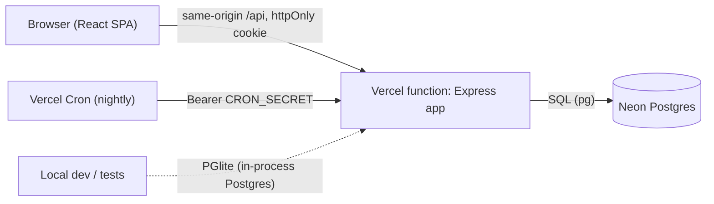

# Cattle Manager

A secure herd-management app for commercial cattle owners: keep the register, vaccinations, weights, daily kraal counts and movements in one place, and reconcile the register against the latest count to spot anything unaccounted for.

**Live demo:** https://cattle-manager-seven.vercel.app — the **Try the live demo** button signs you into a private, pre-filled sandbox, no sign-up needed.

## Highlights

- **Register** — add, edit, search, filter, sort and export animals; click through to a full profile.
- **Vaccinations** — record doses with next-due dates; overdue / due-soon alerts on the dashboard and in the sidebar.
- **Weights** — weigh-ins per animal with a growth chart, total gain and average daily gain.
- **Daily counts & herd status** — log the kraal count and compare it with the active register.
- **Movements** — animals in, out, sold or died, with notes and a monthly summary.
- **Reports** — breed, sex and status breakdowns; CSV exports; full-data JSON export.
- **Accounts** — sign up, change password, export all your data, delete your account.
- **Installable and works offline** — add it to a phone's home screen; open it, read the herd and record counts, weights, vaccinations, movements and new animals with no signal. Changes upload automatically when the connection returns (see [Offline and install](#offline-and-install)).
- **Responsive, accessible UI** — works on a phone, light and dark themes, keyboard friendly, respects reduced motion.

## Tech stack

| Layer | Choice |
| --- | --- |
| Frontend | React 18, Vite, Chakra UI, React Router, Recharts |
| API | Node.js, Express 4, Zod validation, Helmet |
| Database | PostgreSQL (Neon in production, [PGlite](https://pglite.dev) for zero-setup local dev and tests) |
| Hosting | Vercel — static frontend + one serverless function, nightly cron |
| Tests / CI | Vitest, Supertest, Testing Library, GitHub Actions |

## Architecture



The SPA and the API share one origin: Vercel serves `frontend/dist` and rewrites `/api/*` to a single serverless function that wraps the Express app (`api/index.js`). Because everything is same-origin, the session can live in a `SameSite=Strict` cookie and CORS stays switched off.

```
api/            Vercel function entry (re-exports the Express app)
backend/
  src/          app, config, db, auth, security, schemas, routes/, demo seed
  migrations/   versioned SQL (applied by `npm run migrate`)
  test/         API, auth and cross-account isolation tests
frontend/
  src/          pages/, components/, hooks/, context/, utils/
vercel.json     build, rewrites, cron and static-site security headers
```

## Offline and install

Connectivity on a farm is unreliable, so the app is a PWA that keeps working without it.

- **Install** — Chrome/Edge/Android show an **Install app** button in the sidebar; on iPhone it explains *Share → Add to Home Screen*. The app shell (HTML, JS, CSS, Latin fonts, icons) is precached by a service worker (`vite-plugin-pwa`), about 1.2 MB uncompressed on first install. New versions wait for the user to tap **Update now**, so a deploy never reloads the page mid-entry.
- **Local copy** — after sign-in the app downloads the whole farm in one request (`GET /api/sync/snapshot`) and keeps it in IndexedDB, scoped to the signed-in user. With no signal, reads (register, profiles, weights, counts, vaccinations, even the dashboard figures) are answered from that copy.
- **Offline writes** — adding or editing animals and recording counts, movements, weights and vaccinations (and deleting any of them) works with no signal. Each change is applied to the local copy immediately and queued; the queue uploads in order when the connection returns, then the local copy is refreshed from the server. Animals created offline get temporary ids, and anything recorded against them is re-pointed at the real id on upload.
- **No double-counting** — every upload carries an `Idempotency-Key`. The server stores the first response per key (`idempotency_keys`, cleaned nightly) and replays it for a repeat, so a reply lost on a bad connection can't create a duplicate. A key in flight returns `409` with `Retry-After`; a stuck claim is taken over after 60 s.
- **Conflicts and failures** — a queued change the server rejects (for example a tag someone else already used) never blocks the rest; it is listed in the banner with a **Dismiss** button. Deleting something already gone counts as done.
- **Safety** — signing out removes the local copy from the device but keeps changes that haven't uploaded (and asks first); they upload the next time the same person signs in. Two accounts on one device never see each other's data. Deleting the account discards its queue.

Where the code lives: `frontend/src/offline/` (`controller.js` is the adapter/queue, `replica.js` the pure data logic, `storage.js` IndexedDB), `backend/src/idempotency.js`, and `GET /api/sync/snapshot` in `backend/src/routes/herd.js`. To try the service worker locally, use a production build (`npm --prefix frontend run build && npm --prefix frontend run preview`); it is disabled under `npm run dev:web`.

## Security model

Farm data is business-critical, so security is built in rather than bolted on:

| Concern | What the app does |
| --- | --- |
| Sessions | JWT (HS256, pinned) in an **httpOnly, Secure, SameSite=Strict, `__Host-` prefixed cookie** — no token in JavaScript or `localStorage`. Sessions are re-checked against the database on every request, so deleted users, expired demo sandboxes and tokens issued before a password change are rejected immediately. |
| Passwords | bcrypt (cost 12), 10–128 characters, common-password check, constant-time login for unknown users (no username enumeration), generic error messages. Changing a password signs out every other device. |
| Data isolation | Every query is scoped to the signed-in owner (directly or through the owning animal). Someone else's record is **indistinguishable from a missing one (404)**. A dedicated test suite attacks the API as a second user across every resource. |
| Input | Zod schemas on every route (types, lengths, enums, dates, ranges), 10 KB body cap, parameterised SQL only, database `CHECK` constraints as a second line of defence. |
| Abuse | Postgres-backed fixed-window rate limits on sign-up, login (per IP and per account) and demo creation — shared across serverless instances. |
| Stability | Async errors are caught centrally; unexpected failures return a generic 500 with a request id and never leak stack traces, SQL or column names. Bad input can't crash the process (covered by tests). |
| CSRF / CORS | SameSite=Strict cookies plus an `Origin` check on every write; CORS disabled unless origins are explicitly allow-listed. |
| Headers | Strict CSP, HSTS, `nosniff`, frame denial, referrer and permissions policies (API via Helmet, static site via `vercel.json`); API responses are `no-store`. |
| Output | Explicit column lists — no `SELECT *`, no internal ids or `user_id` in responses. CSV exports neutralise spreadsheet formula injection. |
| Your data | Export everything as JSON or delete the account (cascading) from Settings. |
| Secrets | The server refuses to start in production without a strong `JWT_SECRET` and `DATABASE_URL`; `.env` files are git-ignored; `npm audit` runs in CI. |
| Demo mode | Each visitor gets an **isolated, expiring sandbox account** (24 h, auto-deleted by cron) that can't change passwords, export or delete — so demo users never see each other's data. |

## Run it locally

Requires Node 20+. No database or Docker needed — local mode uses an embedded Postgres (PGlite) stored in `backend/.data/`.

```bash
# 1. install both apps
npm run install:all

# 2. (optional) configure the API
cp backend/.env.example backend/.env     # set JWT_SECRET for persistent sessions

# 3. run the API and the web app in two terminals
npm run dev:api     # http://localhost:4000/api
npm run dev:web     # http://localhost:5173  (proxies /api to the API)
```

Open http://localhost:5173 and click **Try the live demo**, or create an account.

```bash
npm test      # backend + frontend tests
npm run lint
```

## Deploy to Vercel

1. **Create a Postgres database** — e.g. a free [Neon](https://neon.tech) project — and copy its connection string.
2. **Generate two secrets** (run twice):
   ```bash
   node -e "console.log(require('crypto').randomBytes(48).toString('hex'))"
   ```
3. **Import the repo in Vercel** (the root `vercel.json` configures everything) and add these environment variables:

   | Variable | Value |
   | --- | --- |
   | `DATABASE_URL` | your Neon connection string |
   | `JWT_SECRET` | first generated secret (32+ chars) |
   | `CRON_SECRET` | second generated secret |

4. **Deploy.** The build runs `npm run migrate` (idempotent, applies `backend/migrations/*.sql`) and then builds the frontend. The nightly cron at `/api/cron/cleanup` removes expired demo sandboxes.
5. Put your deployment URL at the top of this README.

## API overview

All routes are under `/api`; everything except `auth`, `health` and `cron` requires a session cookie.

| Method & path | Purpose |
| --- | --- |
| `POST /auth/signup` · `/auth/login` · `/auth/demo` · `/auth/logout` | Start / end a session |
| `GET /auth/me` | Current user, or `{ user: null }` |
| `GET/POST /cattle` · `GET/PUT/DELETE /cattle/:id` | Register |
| `GET/POST /vaccinations` · `DELETE /vaccinations/:id` | Vaccination records (`?cattle_id=` to filter) |
| `GET/POST /weights` · `DELETE /weights/:id` | Weigh-ins (`?cattle_id=` required) |
| `GET/POST /daily-counts` · `DELETE /daily-counts/:id` | Kraal counts |
| `GET/POST /movements` · `DELETE /movements/:id` | Movements |
| `GET /dashboard` | Dashboard summary in one call |
| `GET /sync/snapshot` | The whole farm (animals, counts, movements, vaccinations, weights) for the offline copy |
| `POST /account/password` · `GET /account/export` · `DELETE /account` | Account self-service |
| `GET /health` · `GET /cron/cleanup` | Health check · cron-only cleanup |

Errors are JSON: `{ "error": "message", "details": [{ "field", "message" }] }`.

## Testing

- **Backend (80 tests)** — auth and sessions, rate limiting, validation and crash-resistance, security headers, CSRF guard, production cookie flags, config safety, demo lifecycle, idempotent retries (replay, concurrency, abandoned claims, cleanup), the offline snapshot, and a **cross-account isolation suite** covering every resource.
- **Frontend (66 tests)** — date/age/vaccination logic, CSV injection protection, the sign-in form, and the **offline layer**: local-copy logic and dashboard figures, queued writes, in-order upload, temporary-id remapping, lost-reply retries, rejected changes, session expiry and two accounts sharing a device.
- **CI** — every push and pull request runs lint, tests, build and `npm audit` (see `.github/workflows/ci.yml`).
